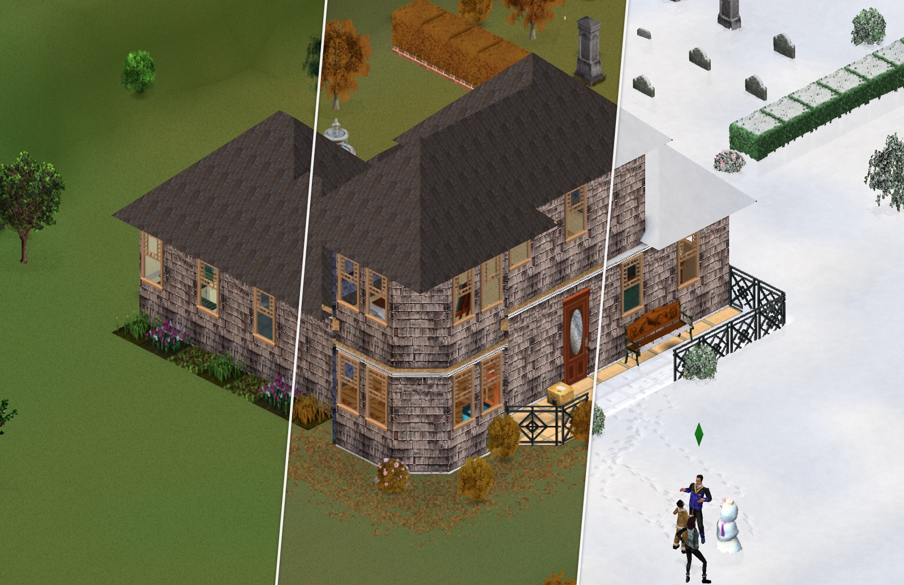

# Plumbob Engine



Cross-platform C# (.NET 9) and SDL3 (`SDL_GPU`) engine and client for *The Sims 1*.

> **Disclaimer**: Plumbob Engine is an independent, clean-room engine reimplementation and is not affiliated with, endorsed by, or sponsored by Electronic Arts Inc. or Maxis. All trademarks belong to their respective owners.

No game assets are included. You need an existing, legally owned installation of *The Sims 1* (such as *Complete Collection* or *Legacy Collection*) containing `GameData` and `UIGraphics`. Game files are read-only and never modified.

## Releases

Standalone archives include the .NET 9 runtime, SDL3, compiled shaders, and preinstalled **Enhanced Graphics** and **Seasons** packs (enabled by default; toggleable in the in-game **Mods** menu):

- macOS (Apple Silicon, macOS 14+): extract `Plumbob-Engine-macOS-arm64.zip` and open `Plumbob Engine.app` (Control-click -> Open on first run; ad-hoc signed).
- Windows (x64): extract `Plumbob-Engine-Windows-x64.zip` and run `SimsSDL.exe`.
- Linux (x64): extract `Plumbob-Engine-Linux-x64.zip` and run `./SimsSDL`.

On first launch, select your *The Sims 1* install directory (or pass `--game <dir>` / set `SIMS_GAME_DIR`).

## User Data

Saves, profiles, and settings are stored outside the game directory:

- macOS: `~/Library/Application Support/PlumbobEngine`
- Windows: `%LOCALAPPDATA%\PlumbobEngine`
- Linux: `$XDG_DATA_HOME/PlumbobEngine` (or `~/.local/share/PlumbobEngine`)

Layout inside the data directory:

- `logs/latest.log`: live diagnostic log for the current/most recent launch (plus rolling `plumbob-engine-*.log` session logs)
- `Settings/install.json`: saved game path
- `Settings/mods.json`: enabled packs, load order, and disabled `Downloads` subfolders
- `Packs/`: user content packs
- `runtime/profiles/`: player profiles, neighborhoods, lots, and rolling save backups (`Saves/backups`)
- `runtime/sessions/`: active runtime session scratch data

## Troubleshooting & Logs

If the game crashes or gets stuck during startup, neighborhood loading, or lot transitions:

1. Press **`Ctrl+Shift+L`** (`Cmd+Shift+L` on macOS) at any time—even on the loading splash screen—to open the `logs` folder with `latest.log` selected, or open it directly:
   - Windows: `%LOCALAPPDATA%\PlumbobEngine\logs\latest.log`
   - macOS: `~/Library/Application Support/PlumbobEngine/logs/latest.log`
   - Linux: `~/.local/share/PlumbobEngine/logs/latest.log`
2. Optional launch flags for troubleshooting on Windows:
   - `SimsSDL.exe --gpu-driver vulkan` or `SimsSDL.exe --gpu-driver direct3d12` to test an alternate GPU backend
   - `SimsSDL.exe --no-audio` to isolate audio device issues
   - `SimsSDL.exe --log C:\path\to\sims.log` to write logs to a custom location

## Controls

- Camera: right-drag to pan, scroll or `+`/`-` to zoom, `[`/`]` or `,`/`.` to rotate
- Simulation: `Space` or `P` to pause, `1`/`2`/`3` for speed, `Tab` to cycle Sims
- View: `Page Up`/`Page Down` for floors, `W` for wall cutaway mode, `Home`/`End` for walls and roofs
- Modes: `F1`–`F5` for Live/Buy/Build/Camera/Options, `S`/`L` to save/load, `Enter`/`Escape` for dialogs
- Editing: `R` rotates held objects, `Delete`/`Backspace` sells, `Ctrl` deletes in Build mode, `Shift` fills rooms or draws wall boxes

## Building

Requires the .NET 9 SDK and SDL3 (`brew install sdl3` on macOS, `SDL3_DIR` / `-SdlDir` on Windows, `SDL3_DIR` or `SDL3_LIB` on Linux).

```sh
# macOS dev app (Sims Native Preview.app) and launcher
./tools/build_native_app.command
SIMS_GAME_DIR="/path/to/The Sims 1" ./tools/play_sdl.command

# Package release archives into dist/
./tools/package_release.command 0.5.1
pwsh -File tools/package_windows.ps1 -Version 0.5.1 -SdlDir C:\path\to\SDL3
./tools/package_linux.sh 0.5.1

# Run tests (asset-dependent tests skip if runtime/game and SIMS_GAME_DIR are absent)
dotnet test native/SimsEngine.Tests/SimsEngine.Tests.csproj -c Release -p:EnableWindowsTargeting=true --nologo
```

## Layout

- `native/SimsEngine`: SimAntics VM, routing, archive/audio/IFF formats, lot state
- `native/SimsSimulation`: lot host, scene exporter, catalog/neighborhood services, headless server (`--serve`)
- `native/SimsSDL`: SDL3 client, GPU renderer, UI overlays, audio output, SPIR-V and Metal shaders
- `native/SimsPluginApi`: C# plugin interfaces
- `native/SimsEngine.Tests`: xUnit test suite
- `tools/`: build, shader, packaging, and bundle validation scripts
